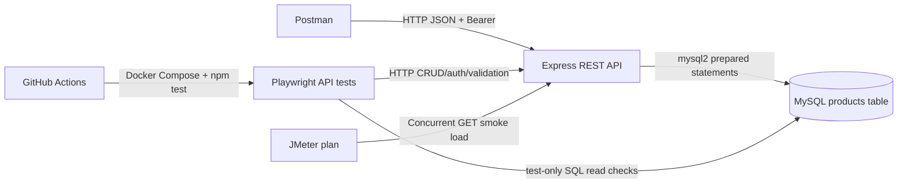

# Interview Guide: REST API + SQL + Performance Framework

## Project pitch

### 30 seconds (English)

> “I built a small REST API test framework around a demo product service. The service uses Express and MySQL; Playwright API tests cover authentication, role permissions, CRUD, validation, boundaries, error responses, and direct SQL persistence checks. I also supplied a Postman collection for manual/API-runner checks, a JMeter load smoke plan, Docker Compose for a repeatable local environment, and GitHub Actions for CI. The JMeter profile is a small baseline, not a production capacity claim.”

### Hindi version

> “Maine Express aur MySQL par ek chhota product REST API banaya aur uske liye Playwright API automation likhi. Tests bearer-token auth aur role access, CRUD, negative/boundary validation, duplicate SKU, error codes aur API response ke against direct SQL persistence verify karte hain. Manual execution ke liye Postman collection, low-volume load smoke ke liye JMeter plan, local setup ke liye Docker Compose aur CI ke liye GitHub Actions hai. Ye demo framework hai, company/production API nahi.”

### 90 seconds

> “The API exposes product list/search, get-by-ID, create, update, and delete endpoints backed by MySQL. Write operations require the admin demo token; reads accept either token. Express validates inputs and returns consistent JSON errors. The database uses a unique SKU constraint and prepared statements. Playwright’s API request fixture drives the endpoints, while a test-only mysql2 pool checks rows after create, update, and delete, so we verify both the HTTP contract and persisted state. A factory fixture generates unique test products and cleans them up. Postman covers the same core API flow manually. JMeter sends a small repeatable health/list workload with status and duration assertions. Compose starts the API and MySQL; Actions starts the services, runs the tests, uploads reports, and tears down its ephemeral database. The demo uses static local tokens; it does not claim JWT/OAuth, production security certification, or high-capacity performance.”

## Architecture and request flow

1. `npm test` starts Playwright Test. Its `request` fixture sends HTTP directly; there is no browser/UI.
2. Express app validates bearer role, route ID, query parameters and JSON body.
3. Route handlers use `mysql2/promise` pool and parameterized `execute()` calls.
4. MySQL enforces unique SKU and numeric/data constraints.
5. Playwright checks HTTP status/body and queries MySQL directly to confirm saved values.
6. Test fixture deletes any created product after the test.
7. CI builds/starts MySQL + API with Compose, runs tests, uploads reports and removes CI containers/volume.

## File-by-file walkthrough

| File | Responsibility |
|---|---|
| `package.json` / `package-lock.json` | Commands and locked npm dependency graph. |
| `src/server.js` | Loads environment, initializes DB schema, starts HTTP server and handles shutdown. |
| `src/app.js` | Express middleware, auth, validation, routes, prepared SQL, error mapping. |
| `src/db.js` | Configured mysql2 promise pool and idempotent demo schema initialization. |
| `src/sql/schema.sql` | Product table, field types, unique SKU, indexes and constraint. |
| `tests/api.spec.js` | Playwright API tests, admin/read token helpers, test product factory and SQL checks. |
| `playwright.config.js` | Test directory, base URL, CI retry/workers, reporter, trace. |
| `postman/api-collection.json` | Collection Runner requests and assertions; create step stores ID/SKU for later calls. |
| `performance/api-load-test.jmx` | JMeter 20-user/5-loop local load smoke plan. |
| `Dockerfile` | Builds the Node API container with production dependencies. |
| `compose.yaml` | MySQL + API services, ports, volume and health-gated startup. |
| `.env.example` | Documented local configuration sample. Never put real secrets here. |
| `.github/workflows/api-tests.yml` | GitHub Actions CI lifecycle. |
| `.gitignore` | Excludes credentials, node_modules and generated reports. |
| `README.md` | Setup, API contract, run instructions and limitations. |

## Database details

`products` has an auto-increment `BIGINT` ID, unique 40-character SKU, product name, optional description, `DECIMAL(10,2)` price, unsigned stock, created/updated timestamps, SKU uniqueness, and a name index. `price` is a fixed decimal because currency should not rely on binary floating point in the database. The sample API maps returned numeric values to JSON numbers. All external SQL values use placeholders.

There is no separate seed database: tests create their own unique rows and delete them. The schema file runs on API startup with `CREATE TABLE IF NOT EXISTS`; this is enough for a demo, but schema changes in a real project should use ordered/versioned migrations. Playwright direct SQL is a test assertion, not an API behavior.

## Endpoint and status-code recall

- `GET /health` → public database readiness, 200.
- `GET /api/products` → read token or admin; paged/search list, 200.
- `GET /api/products/:id` → read; 200 or 404; malformed ID 400.
- `POST /api/products` → admin; 201, invalid body 400, duplicate SKU 409.
- `PUT /api/products/:id` → admin; 200, invalid 400, missing 404.
- `DELETE /api/products/:id` → admin; 204, missing 404.
- Missing/invalid bearer: 401. Valid read token on a write route: 403.

The API error envelope is `{ error: { code, message, details? } }`. Unexpected server errors log details server-side and return a generic 500 envelope.

## Test design / interview answers

**Why test API and SQL separately?** HTTP assertions check the public contract. A direct SQL read after POST/PUT/DELETE checks persistence. Either alone can miss a mismatch between response and stored state.

**Why Playwright APIRequestContext?** It sends HTTP without browser startup and supports requests, response assertions, fixtures, retries and HTML/trace reporting in the same test runner. This repo uses the built-in `request` fixture.

**Why Postman too?** It gives a human-readable manual collection and Collection Runner flow for quick exploration. Playwright is the repeatable CI automation here. The Postman collection does not itself run SQL checks.

**Why use prepared statements?** User values remain bound parameters rather than SQL syntax. The injection-like search test verifies the input is treated as data. Validation remains necessary; parameterization does not replace validation or authorization.

**401 vs 403?** 401 means credentials are missing/invalid. 403 means a recognized read-only token attempted an admin-only operation.

**PUT vs PATCH?** This demo uses PUT as full replacement of the editable product representation. There is no PATCH endpoint.

**Why unique test data?** Parallel requests should not collide on the unique SKU index. Unique rows allow each test to be independent and safe to rerun.

**How is test data cleaned?** `productFactory` tracks IDs created by each test and deletes them during fixture teardown. CI also disposes its temporary Compose volume at job end.

**What is the purpose of Docker Compose?** It starts services with repeatable network names, config and readiness checks. The API reaches MySQL by service name `mysql`; host-side tests reach the published port.

**What does JMeter measure here?** Response samples, status/assertion failures, elapsed times/latency distribution, and throughput under a small defined concurrency. It is not a production capacity benchmark. Look at p90/p95/p99, error rate and server/DB resource usage before making conclusions.

**Why not run high load in CI?** Hosted runners and shared environments are noisy, and CI should not stress shared/production systems. Keep CI functional checks stable; run controlled performance profiles against an approved environment.

## Likely follow-up questions (quick answers)

1. **Which DB?** MySQL 8.4 in Compose; mysql2 promise pool from Node.
2. **How do you validate CRUD persistence?** API operation then parameterized SELECT by generated ID; compare fields; after DELETE assert zero rows.
3. **How do you test duplicate data?** Create one unique SKU, POST it again, expect 409, query DB and assert a single row.
4. **How are credentials handled?** Environment variables; `.env` ignored. Example tokens are demo-only and must be changed outside local learning.
5. **Is this JWT auth?** No. It is static bearer-token role gating for a demo, no expiry/user identity/rotation.
6. **What prevents SQL injection?** `pool.execute` with placeholders and validation. Search query is parameterized and tested with injection-like text.
7. **What security controls exist?** Helmet headers, JSON size cap, input validation, bearer auth/role check, prepared SQL, generic server error response. This is basic demo hardening, not OWASP certification.
8. **What OWASP API risks remain?** Static token lifecycle, rate limiting/abuse controls, granular resource ownership, audit logging, TLS/secret rotation and richer authorization need production design.
9. **What does boundary testing cover?** Zero price/stock accepted; invalid negative price, fractional stock, invalid SKU/name, high pagination limit rejected.
10. **Why is price `DECIMAL`?** Exact fixed-scale currency storage; binary floating-point values can round unexpectedly.
11. **Why use a unique SKU index if validation exists?** Validation checks input shape; DB constraint protects concurrent requests and guarantees uniqueness at the persistence layer.
12. **Does the API test real payment/orders?** No. It is a product catalog CRUD sample.
13. **Does Postman verify SQL?** No. SQL assertions are in Playwright Node tests via mysql2.
14. **Does CI execute JMeter?** No. It runs API+SQL functional tests. The JMeter plan is manual/controlled so CI does not create noisy load.
15. **What did you run?** Report only real executions. This scaffold still needs local Docker/API test execution before claiming pass counts.
16. **Is this a real enterprise app?** No. It is a self-contained portfolio demo API and test framework.
17. **What if schema changes?** Use versioned migrations, not only `CREATE TABLE IF NOT EXISTS`.
18. **What would you add next?** OpenAPI schema/contract validation, JWT/OAuth test matrix, pagination sorting boundaries, concurrency tests, migrations, data seeding, response schema validation, test sharding, JMeter CLI report artifact in an approved CI profile.
19. **Can public internet endpoints be load-tested?** Only with explicit authorization. This project targets the local demo API.
20. **What is a performance SLA?** A defined environment/workload and latency/error target agreed by stakeholders; this plan does not establish one.
21. **What is the difference between load and stress test?** Load checks expected traffic levels; stress pushes beyond expected capacity to find failure/limits. Current plan is a small load smoke.
22. **Why `npm ci` in CI?** It installs exact lockfile dependencies reproducibly and fails on manifest/lock mismatch.
23. **What happens after a failed CI run?** Download the HTML report and `test-results` artifact, inspect failure details/trace, reproduce against local Compose, then fix root cause.
24. **Why clean DB volume in CI?** Runner DB is disposable; this prevents state leaking across jobs. Local `docker compose down` without `-v` preserves data.
25. **Is the SQL initialization a migration system?** No. It's idempotent first-run schema setup only.
26. **How do you prevent tests racing?** Unique SKU per test, independent rows, isolated test factory; no shared fixed product row.
27. **Why check health without auth?** Container readiness can be checked without placing a secret in healthcheck configuration. It only returns service/database readiness.
28. **What are the JMeter virtual users?** Threads that issue the configured HTTP sampler requests; 20 users × 5 loops × 2 samplers is up to 200 request samples if all complete.
29. **What is a ramp-up?** The time JMeter takes to start all virtual users; 20 threads over 10 seconds avoids starting them simultaneously.
30. **What does a duration assertion mean?** Each sample exceeding the configured 2500 ms threshold is marked failed; it is a demo guardrail, not a percentile SLA.

## Honest scope and limitations

- This repo includes a sample API, not merely tests against a third-party API.
- Only product catalog CRUD is implemented. There is no cart/order/payment domain.
- Tokens are static demo values, not production auth.
- No JWT/OAuth, user database, rate limiting, audit trail, role ownership, or secrets manager integration.
- SQL schema creation is not versioned migration management.
- Postman handles HTTP only; direct SQL assertions are in Playwright.
- JMeter is a low-volume local smoke profile; no production capacity result is claimed.
- CI runs API/SQL checks; it intentionally does not generate load.
- Before quoting pass totals, run it and report the actual environment/results.

## Resume bullets after you have run it

Only after verifying locally, describe accurately, e.g.:

- Built a sample Express REST API with MySQL product CRUD and role-protected bearer-token endpoints.
- Automated positive, negative, boundary, authorization, and CRUD API scenarios with Playwright; cross-checked persistence with parameterized SQL assertions.
- Added an importable Postman collection, Docker Compose environment, and GitHub Actions API/SQL workflow.
- Created a JMeter load smoke plan with configurable concurrency, response-code assertions, and sample-duration limits; documented that it is a local baseline, not a production capacity result.
